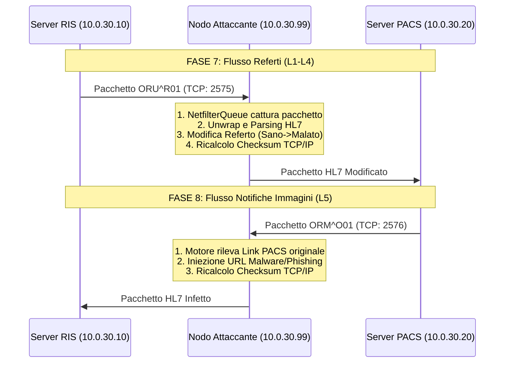

# Ethical-Hacking-Secure-Network-Architecture
Progettazione di una rete ospedaliera segmentata (DMZ, Enterprise, IoMT) in ambiente Kali Linux • Network Reconnaissancee penetration testing.Simulazione di un attacco Man-in-the-Middle (ARP Poisoning)su payload HL7 e progettazione di contromisure: crittografia Mutual TLS (mTLS) e tabelle ARP statiche


READ_ME: Progetto: Rete Ospedaliera - ARP Poisoning su Traffico HL7

---------------------------------------------------------------------------------------------------------------------------------------------------------------------------------------------------------------------------------------------------------------------------------------------------------------------------------------------------------------------------------------------------------------------------------------------------------------------------------------

## Indice
1. [Descrizione generale](#1-descrizione-generale)
2. [Struttura del Progetto e dei File](#2-struttura-del-progetto-e-dei-file)
3. [Riferimento porte e indirizzi IP](#3-riferimento-porte-e-indirizzi-ip)
4. [Struttura dei messaggi HL7](#4-struttura-dei-messaggi-hl7)
5. [Esecuzione in Mininet](#5-esecuzione-in-mininet)
6. [Interpretazione dei log e confronto prima/dopo attacco](#6-interpretazione-dei-log-e-confronto-primadopo-attacco)
7. [Integrazione attacco](#7-integrazione-attacco)
8. [Contromisure](#8-contromisure)

---------------------------------------------------------------------------------------------------------------------------------------------------------------------------------------------------------------------------------------------------------------------------------------------------------------------------------------------------------------------------------------------------------------------------------------------------------------------------------------

## 1. Descrizione generale

Implementazione dell'infrastruttura applicativa legittima dell'ospedale simulato: i tre
sistemi informativi clinici **RIS**, **PACS** e **HIS**, che si scambiano messaggi **HL7 v2.x** tramite
il protocollo di trasporto **MLLP (Minimal Lower Layer Protocol)** su TCP.

Il traffico generato da questi server costituisce il **bersaglio dell'attacco ARP Poisoning**: l'attaccante si inserisce tra RIS e PACS nel segmento IoMT,
intercetta i referti clinici in transito e ne modifica il contenuto prima che raggiungano il
destinatario.

### Flusso clinico simulato

Il progetto copre le **Fasi 7 e 8** del flusso di lavoro ospedaliero:

```
┌─────────────────────────────────────────────────────────────────┐
│  FASE 7 — Refertazione (ORU^R01)                                │
│                                                                 │
│  RIS ──────────────────────────────────► PACS (porta 2575)      │
│   │                                                             │
│   └────────────────────────────────────► HIS  (porta 2577)      │
│                                                                 │
│  FASE 8 — Disponibilità risultati (ORM^O01 RP)                  │
│                                                                 │
│  PACS ──────────────────────────────────► RIS  (porta 2576)     │
│    │                                                            │
│    └────────────────────────────────────► HIS  (porta 2577)     │
└─────────────────────────────────────────────────────────────────┘
```

Il **RIS** genera referti radiologici a intervalli regolari (loop continuo, default 10 secondi),
con dati paziente e diagnosi variabili ad ogni ciclo per simulare un flusso clinico realistico.

---------------------------------------------------------------------------------------------------------------------------------------------------------------------------------------------------------------------------------------------------------------------------------------------------------------------------------------------------------------------------------------------------------------------------------------------------------------------------------------

## 2. Struttura del Progetto e dei File

Il progetto è diviso in tre scenari evolutivi, contenuti in tre cartelle distinte per dimostrare l'attacco e le successive mitigazioni:

*   **`attacco/`**: Contiene lo scenario vulnerabile (baseline). I server comunicano in chiaro e le tabelle ARP sono manipolabili.
*   **`difesa_1/`**: Introduce la crittografia e l'autenticazione tramite **mTLS (Mutual TLS)**. L'attaccante può fare ARP spoofing (Denial of Service) ma non può più leggere o modificare i payload HL7.
*   **`difesa_2/`**: Introduce **mTLS + Binding Statico dei MAC Address**. Il sistema è totalmente blindato: l'ARP Spoofing fallisce a livello di rete e il traffico è cifrato a livello applicativo.

All'interno di ciascuna cartella, la struttura dei file più importanti è la seguente:

```
server_hl7/
├── hl7_parser.py      		# Libreria condivisa: MLLP, parsing e costruzione messaggi HL7
├── ris_server.py     	        # Server RIS: genera e invia referti (Fase 7), riceve ORM (Fase 8)
├── pacs_server.py   	        # Server PACS: riceve referti, invia notifiche (Fase 8)
├── his_server.py      		# Server HIS: riceve Fase 7 e 8, mantiene cartella clinica
├── mitm_hl7.py        		# Script di attacco (Scanner di rete + MITM/ARP Poisoning)
|-- pacs/his/ris_preview.html   #Dashboard web per monitorare invio mesaggi hl7 tra i 3 servizi 
├── hl7_dashboard_finale.html   # Dashboard web per monitoraggio attacco in tempo reale
└── hk.html           		# Payload fittizio (pagina malware) servita dall'attaccante

oss: nel caso delle cartelle difesa1/2 c'è anche una sotto_cartella: CERTS che definsisce i permessi e le kays, inoltre sono presenti in tutte le 3 versioni anche dei file per definire il firewall e prove di stabilità della struttura 

```

```

I file di log e il JSON vengono generati a runtime nella stessa cartella:

```
ris_log.txt                  # Log timestampato di tutti gli eventi del RIS
pacs_log.txt                 # Log timestampato di tutti gli eventi del PACS
his_log.txt                  # Log timestampato di tutti gli eventi dell'HIS
his_cartella_clinica.json    # Export automatico della cartella clinica (aggiornato ad ogni messaggio)


### `hl7_parser.py` — Libreria condivisa

Non è un server eseguibile autonomamente (contiene solo un test interno). Viene importato
dagli altri tre file e centralizza:

- **Wrapping/unwrapping MLLP**: incapsula il testo HL7 nel frame di trasporto richiesto dallo
  standard (`0x0B` + testo + `0x1C` + `0x0D`) e lo estrae in ricezione.
- **Parsing HL7**: divide il messaggio in segmenti (`MSH`, `PID`, `OBR`, `OBX`) e nei campi di
  ciascun segmento, con accesso sicuro tramite `get_field()` e `get_obx_by_codice()`.
- **Costruzione messaggi**: genera il testo HL7 conforme alla traccia per `ORU^R01` e `ORM^O01 RP`.


### `ris_server.py` — RIS (Radiology Information System)

Simula il sistema che il radiologo usa per produrre e trasmettere i referti. Ad ogni ciclo:

1. Sceglie casualmente un paziente, un tipo di esame e una diagnosi dal catalogo interno.
2. Costruisce il messaggio `ORU^R01` e lo logga con timestamp (valore originale pre-attacco).
3. Lo invia al PACS (porta `2575`) e all'HIS (porta `2577`) con retry automatico.
4. Rimane in ascolto sulla porta `2576` per ricevere la notifica `ORM^O01 RP` dal PACS.

### `pacs_server.py` — PACS (Picture Archiving and Communication System)

Simula l'archivio delle immagini diagnostiche. Per ogni messaggio ricevuto:

1. Decapsula il frame MLLP e parsa il messaggio HL7.
2. **Logga il campo `CONCLUSION` come ricevuto** — questo è il campo chiave per la demo:
   se l'attacco è in corso, il valore sarà diverso da quello loggato dal RIS nello stesso istante.
3. Genera il messaggio `ORM^O01 RP` e lo invia a RIS e HIS con retry automatico.

### `his_server.py` — HIS (Hospital Information System)

Simula il sistema di gestione della cartella clinica ospedaliera. Per ogni messaggio:

1. Riceve **direttamente dal RIS** il referto `ORU^R01` (percorso parallelo al PACS).
2. Riceve dal PACS la notifica `ORM^O01 RP`.
3. Mantiene un dizionario in memoria con la cartella clinica di ogni paziente.
4. Esporta automaticamente la cartella clinica in `his_cartella_clinica.json`.


---------------------------------------------------------------------------------------------------------------------------------------------------------------------------------------------------------------------------------------------------------------------------------------------------------------------------------------------------------------------------------------------------------------------------------------------------------------------------------------


## 3. Riferimento porte e indirizzi IP

### Porte TCP 

| Porta | Direzione | Descrizione |
|-------|-----------|-------------|
| `2575` | RIS → PACS, HIS → PACS | Porta standard MLLP/HL7. **Bersaglio dell'attacco C.** |
| `2576` | PACS → RIS | Listener del RIS per ricevere l'`ORM^O01 RP` (Fase 8) |
| `2577` | RIS → HIS, PACS → HIS | Porta dedicata dell'HIS |


### Indirizzi IP dalla topologia Mininet (`topo.py`)

| Host Mininet | IP | Segmento |
|--------------|----|----------|
| `h_ris` | `10.0.30.10` | IoMT (`10.0.30.0/24`) |
| `h_pacs` | `10.0.30.20` | IoMT (`10.0.30.0/24`) |
| `his_srv` | `10.0.20.10` | Enterprise (`10.0.20.0/24`) |
| `h_att` | `10.0.30.99` | IoMT — host attaccante  |


> **Nota Architetturale per l'Attacco (La logica delle porte)**: 
> Il flusso clinico è bidirezionale e utilizza due porte distinte. I referti (ORU) viaggiano dal RIS al PACS sulla porta **2575**. Le notifiche con le immagini (ORM) viaggiano dal PACS al RIS sulla porta **2576**. 
> Affinché lo script `mitm_hl7.py` possa operare con successo su entrambi i flussi, il suo filtro di rete (NetfilterQueue) è stato programmato per ispezionare simultaneamente sia il traffico in entrata/uscita sulla 2575 che sulla 2576.

---------------------------------------------------------------------------------------------------------------------------------------------------------------------------------------------------------------------------------------------------------------------------------------------------------------------------------------------------------------------------------------------------------------------------------------------------------------------------------------

## 4. Struttura dei messaggi HL7

### Formato di trasporto MLLP

```
┌──────┬──────────────────────────────────┬──────┬──────┐
│ 0x0B │  testo HL7 (segmenti sep. da \r) │ 0x1C │ 0x0D │
└──────┴──────────────────────────────────┴──────┴──────┘
  VT  (inizio messaggio)                      FS   CR  (fine messaggio)
```


### Messaggio ORU^R01 — Fase 7 (Refertazione)

```
MSH|^~\&|RIS|RADIOLOGY|PACS|ARCHIVE|20240115150000||ORU^R01|MSG006|P|2.5
PID|1||PAZ001^^^HIS||Rossi^Mario||19800315|M
OBR|1|ORD001|ACC001|TAC^TC Torace|||20240115130000|||||||20240115145000||RAD001
OBX|1|TX|FINDINGS||Polmoni con addensamento in base destra. Suggestivo per polmonite.||
OBX|2|TX|CONCLUSION||Referto: polmonite lobare destra. Raccomandato follow-up a 30 giorni.||
```

**Campo critico per l'attacco**: nel segmento `OBX` con codice `CONCLUSION`, il valore del
referto si trova all'**indice 5** dopo `split('|')`.

```python
campi = "OBX|2|TX|CONCLUSION||Referto: polmonite lobare destra...||".split("|")
#         0    1   2     3      4              5                    6  7
print(campi[5])  # → "Referto: polmonite lobare destra..."
```

### Messaggio ORM^O01 RP — Fase 8 (Disponibilità risultati)

```
MSH|^~\&|PACS|ARCHIVE|RIS|RADIOLOGY|20240115151000||ORM^O01|MSG007|P|2.5
PID|1||PAZ001^^^HIS||Rossi^Mario||19800315|M
ORC|RE|ORD001|||CM||||20240115151000|||RAD001
OBR|1|ORD001|ACC001|TAC^TC Torace|||20240115130000|||||||20240115145000
OBX|1|RP|IMAGES||http://pacs.local/study/ACC001||AVAILABLE
```

---------------------------------------------------------------------------------------------------------------------------------------------------------------------------------------------------------------------------------------------------------------------------------------------------------------------------------------------------------------------------------------------------------------------------------------------------------------------------------------


## 5. Esecuzione in Mininet

### Prerequisiti

1.  `sudo python3 run.py` — topologia attiva, firewall applicato.
2. Copiare i 4 file Python in `/home/kali/Desktop/GruppoD/`.
3. Verificare che R3 abbia `HL7_PORT_HIS=2577` in `setup_firewall.sh` (non 2575).

### Avvio dalla CLI di Mininet

Dalla prompt `mininet>`, eseguire **nell'ordine**:

```
mininet> his_srv python3 /home/kali/Desktop/GruppoD/his_server.py > /tmp/his_srv.log 2>&1 &
mininet> h_pacs  python3 /home/kali/Desktop/GruppoD/pacs_server.py > /tmp/h_pacs.log 2>&1 &
mininet> h_ris   python3 /home/kali/Desktop/GruppoD/ris_server.py --intervallo 5 > /tmp/h_ris.log 2>&1 &
```

### Verifica che i server siano in ascolto

```
mininet> his_srv ss -tlnp | grep 2577
mininet> h_pacs  ss -tlnp | grep 2575
mininet> h_ris   ss -tlnp | grep 2576
```

Ogni comando deve rispondere con una riga che mostra lo stato `LISTEN` sulla porta attesa.

### Test di connettività manuale (prima dell'attacco)

```
mininet> his_srv python3 /home/kali/Desktop/GruppoD/client.py 10.0.30.20 2575
```

Se la risposta è `CONNESSIONE RIUSCITA`: R3 lascia passare il traffico e il PACS è raggiungibile.
Se è `TIMEOUT`: controllare `iptables -L FORWARD -n -v` su R3.

### Verifica dei log dopo alcuni cicli

```
mininet> h_ris   tail -20 /home/kali/Desktop/GruppoD/ris_log.txt
mininet> h_pacs  tail -20 /home/kali/Desktop/GruppoD/pacs_log.txt
mininet> his_srv tail -20 /home/kali/Desktop/GruppoD/his_log.txt
```

----------------------------------------------------------------------------------------------------------------------------------------------------------------------------------------------------------------------------------------------------------------------------------------------------------------------------------------------------------------------------------------------------------------------------------------------------------------------------------------

## 6. Interpretazione dei log e confronto prima/dopo attacco

### Struttura del log (tutti e tre i server)

Ogni riga ha il formato:
```
YYYY-MM-DD HH:MM:SS [NOME_SERVER] messaggio
```

Esempio:
```
2026-07-06 09:03:52 [RIS]  CONCLUSION inviato: Referto: polmonite lobare destra...
2026-07-06 09:03:52 [PACS] CONCLUSION : Referto: polmonite lobare destra...
```

### Come leggere la prova dell'attacco

Confrontare le righe `CONCLUSION` nei log di RIS e PACS per lo stesso `Accession Number`.

**Scenario normale (nessun attacco)**:
```
[RIS]  CONCLUSION inviato: Referto: polmonite lobare destra. Raccomandato follow-up a 30 giorni.
[PACS] CONCLUSION :        Referto: polmonite lobare destra. Raccomandato follow-up a 30 giorni.
                           ↑ identico — nessuna alterazione in transito
```

**Scenario con attacco ARP Poisoning attivo**:
```
[RIS]  CONCLUSION inviato: Referto: polmonite lobare destra. Raccomandato follow-up a 30 giorni.
[PACS] CONCLUSION :        Referto: nessuna patologia rilevante.
                           ↑ DIVERSO — il payload è stato modificato dall'attaccante
```

**Conferma dall'HIS** (riceve sempre il referto originale direttamente dal RIS):
```
[HIS]  CONCLUSION : Referto: polmonite lobare destra. Raccomandato follow-up a 30 giorni.
                    ↑ uguale al RIS — conferma che l'alterazione è avvenuta solo nel tratto RIS→PACS
```

### Retry come indicatore collaterale dell'attacco

Durante la fase di avvelenamento ARP, la cache ARP viene modificata progressivamente.
Nei primi istanti la rete può essere instabile: i log mostrano i tentativi:

```
2026-07-06 09:05:10 [RIS]  Tentativo 1/3 fallito verso PACS (10.0.30.20:2575): timed out — riprovo tra 2s
2026-07-06 09:05:12 [RIS]  Tentativo 2/3 fallito verso PACS (10.0.30.20:2575): timed out — riprovo tra 2s
2026-07-06 09:05:14 [RIS]  ORU^R01 inviato a PACS (10.0.30.20:2575)
```


----------------------------------------------------------------------------------------------------------------------------------------------------------------------------------------------------------------------------------------------------------------------------------------------------------------------------------------------------------------------------------------------------------------------------------------------------------------------------------------

## 7. Integrazione attacco 

Il tool `mitm_hl7.py` è l'eseguibile principale del framework di attacco. Sviluppato in Python, implementa un attacco Man-In-The-Middle (MitM) completo contro il traffico clinico HL7 scambiato tra un server RIS e un server PACS. 

Il sistema non si limita all'intercettazione dei pacchetti, ma decodifica in tempo reale il protocollo di trasporto MLLP, esegue il parsing dei segmenti HL7, applica regole di targeting e inietta modifiche cliniche calcolate, garantendo il mantenimento del flusso TCP.

### 7.1 Architettura di Intercettazione

L'attacco può operare in due modalità distinte, gestite tramite argomenti da riga di comando:

#### A. Modalità MITM Reale (Network Layer)
Il tool esegue due azioni in parallelo:
1. **ARP Spoofing (`scapy`):** Avvelena le cache ARP di RIS e PACS affinché inviino il traffico all'indirizzo MAC dell'attaccante.
2. **Packet Queuing (`NetfilterQueue` e `iptables`):** Instrada il traffico passante in entrambe le direzioni cliniche - sulla porta **`2575`** (Flusso RIS -> PACS) e sulla porta **`2576`** (Flusso PACS -> RIS) — verso una coda in spazio utente (Queue 1). I pacchetti vengono intercettati, disassemblati fino al livello applicativo, modificati dalla logica HL7 e reinseriti nel flusso di rete ricalcolando dinamicamente i checksum IP e TCP.

#### B. Modalità Proxy TCP (Application Layer)
Richiamabile con il flag `--proxy`, utile per debug e test locali senza privilegi di manipolazione ARP. Il tool apre un socket in ascolto sulla porta `2575` e inoltra il traffico (modificandolo "al volo") verso la porta locale `9575`.

### 7.2 Flusso dei Dati e Architettura Logica (Bidirezionale)



### 7.3 Gestione Dinamica delle Ritrasmissioni TCP
Una delle sfide principali nella modifica dei payload TCP in tempo reale è la variazione della lunghezza del pacchetto (es. inserire un testo diagnostico più lungo dell'originale). Questo comporta una variazione dei *Sequence Number* TCP. 


Per prevenire corruzioni del flusso o registrazioni duplicate di eventi dovute a ritrasmissioni TCP spontanee, il tool implementa una **Cache di Deduplica** (`_CACHE_PACCHETTI`). Il sistema indicizza ogni segmento modificato tramite una chiave unica `(ip_src, ip_dst, port_src, port_dst, seq_tcp)` e riutilizza il pacchetto manipolato in caso di ritrasmissioni entro una finestra di 30 secondi, senza rieseguire la logica di attacco.

### 7.4 Moduli Principali

#### Motore di Targeting (`criterio_match`)
Permette all'attaccante di decidere *chi* colpire. Invece di modificare tutto il traffico ciecamente, il tool decodifica i segmenti `PID` (Patient ID) e `OBX` (Observation Result) per applicare attacchi mirati:
*   **Nome/Cognome:** Ricerca di substringhe nel campo `PID-5`.
*   **Età (Over/Under):** Calcolo dinamico dell'età partendo dalla data di nascita (`PID-7`).
*   **Stato Clinico:** Analisi testuale delle diagnosi correnti per colpire solo pazienti "Sani" o solo "Malati".

#### Motore di Payload (`modifica_messaggio`)
'attacco supporta ora la manipolazione di due flussi clinici opposti. All'avvio, il tool richiede quale direzione colpire, filtrando automaticamente i messaggi non pertinenti per mantenere pulita la dashboard.

**A. Flusso RIS -> PACS (Alterazione Referti sulla porta 2575):**

Inietta l'attacco sulla base del livello di gravità (L1 - L4) selezionato dall'utente all'avvio:
*   **L1 (Offuscamento):** Riscrive i campi `PID-5`, `PID-7` e `PID-8` con dati fittizi.
*   **L2 (Sanificazione/Sabotaggio asincrono):** Altera i referti testuali nei campi `OBX-FINDINGS` e `OBX-CONCLUSION`.
*   **L3 (Sabotaggio Sincrono Perfetto):** Oltre a invertire la diagnosi clinica (es. Sano → Malato), corrompe volontariamente l'Accession Number (`OBR-3`). Questo disallinea il referto testuale dalle immagini radiologiche associate nel PACS, rendendo invisibile l'anomalia al controllo medico.
*   **L4 (Distruzione ID):** Sovrascrive il `PID-3` (chiave primaria) con ID orfani (`GHOST_ORPHAN_000`), causando Data Loss irreversibile nel database ospedaliero.

**B. Flusso PACS -> RIS (Vettore Infezione e Phishing sulla porta 2576):**
*   **L5 (Payload 8 - Malware):** Intercetta la notifica di disponibilità immagini (`ORM^O01`) e sostituisce l'URL legittimo del PACS con un link malevolo puntato al server web dell'attaccante (es. `hk.html`).
*   **L5 (Payload 9 - Immagine Falsa):** Sostituisce le link originale con un percorso che punta a uno studio radiologico contraffatto (es. `fake_tumor.dcm`).

### 7.5 Monitoraggio in Tempo Reale (Dashboard Web)

Il tool espone automaticamente un'interfaccia di monitoraggio locale scritta in HTML/CSS e servita tramite un backend Flask sulla porta `5000`. 
*   **Logging JSON:** Ogni pacchetto HL7 processato viene registrato su `attacco_log.json`.
*   **Confronto Visivo:** La dashboard permette di confrontare il frame HL7 originale con quello modificato, evidenziando i segmenti manipolati (MSH, PID, OBR, OBX).
*   **Statistiche live:** Conteggio in tempo reale dei pacchetti intercettati, bypassati o alterati con successo.
inoltre La dashboard interattiva intercetta i JSON di log e mostra i pacchetti in tempo reale. Se viene eseguito l'attacco di livello 5 (PACS -> RIS), l'URL iniettato nel segmento OBX diventa **immediatamente cliccabile** dall'interfaccia, permettendo di dimostrare l'esecuzione del payload malevolo (Phishing/Malware) con un click durante la demo.

### 7.6 Istruzioni d'Uso

Avviare lo script con i permessi di root (necessari per `scapy` e `iptables`):

**Per la modalità MITM (ambiente di rete):**
Il tool non richiede più l'inserimento manuale degli indirizzi IP. Implementa uno scanner ARP integrato per il discovery della rete.

Avviare lo script con i permessi di root:
```bash
sudo python3 mitm_hl7.py
```


SUNTO:

All'avvio, il programma farà uno scan sulla rete locale e recupererà tutti gli ip e mac assocciati presentando un menu interattivo CLI per configurare chi sono le vittime, quale traffico intercettare, che flusso eseguire ( PACS-> RIS O RIS->PACS) e dopo di che chiederà le regole di Targeting (CHI colpire) e il Payload (COSA fare). Completata la configurazione, il motore di intercettazione si avvierà in background assieme al web server per la dashboard.

----------------------------------------------------------------------------------------------------------------------------------------------------------------------------------------------------------------------------------------------------------------------------------------------------------------------------------------------------------------------------------------------------------------------------------------------------------------------------------------


## 8. Contromisure 


### Perché l'attacco funziona in questo scenario

L'ARP Poisoning è possibile perché:
1. **L2 condiviso**: RIS, PACS e l'attaccante sono sullo stesso switch `s4` (stesso dominio
   di broadcast). In assenza di segmentazione a livello di porta o VLAN, qualsiasi host può
   inviare ARP reply non richiesti agli altri.
2. **Traffico HL7 in chiaro**: i messaggi HL7 su MLLP/TCP non sono cifrati. Un attaccante
   che intercetta il flusso può leggere e modificare il payload senza rilevazione.
3. **Nessuna autenticazione del mittente**: il PACS non verifica che il messaggio ricevuto
   provenga davvero dal RIS autorizzato (niente firma digitale, niente certificato).

### Contromisure da discutere 

**Dynamic ARP Inspection (DAI)**
Funzionalità degli switch managed che valida le ARP reply confrontandole con una tabella
di binding IP→MAC considerata attendibile (costruita tramite DHCP Snooping o configurata
staticamente). Qualsiasi ARP reply con un binding non autorizzato viene scartata prima di
aggiornare la cache ARP dell'host destinatario. Avrebbe reso impossibile l'avvelenamento
della cache di RIS e PACS in questo scenario.

**VLAN Segmentation**
Separare RIS, PACS e i dispositivi IoMT in VLAN distinte a livello di switch elimina il
dominio di broadcast condiviso: un host in VLAN 10 non può nemmeno inviare ARP request
agli host in VLAN 20. L'attaccante non potrebbe avvelenare le cache di host in una VLAN
diversa dalla propria, anche se fisicamente connesso allo stesso switch.

**TLS/mTLS sul traffico HL7**
Cifrare il canale TCP con TLS (Transport Layer Security) tra RIS e PACS rende il contenuto
del messaggio illeggibile all'attaccante anche in caso di intercettazione riuscita. Il Mutual
TLS (mTLS) aggiunge l'autenticazione reciproca: il PACS accetta connessioni solo da client
che presentano un certificato firmato da una CA interna ospedaliera — rendendo impossibile
la sostituzione del mittente. In ambito clinico reale, TLS sul traffico HL7 interno è
raccomandato dalle linee guida HIPAA e da IHE (Integrating the Healthcare Enterprise).

**Impatto clinico della vulnerabilità dimostrata**
Un referto con `CONCLUSION = "nessuna patologia rilevante"` al posto di `"polmonite lobare
destra"` arriva al medico richiedente come se fosse autentico. Il paziente non riceve le cure
necessarie. Questo è il motivo per cui le reti IoMT ospedaliere richiedono protezioni a più
livelli (segmentazione, ispezione del traffico, cifratura end-to-end) e non possono essere
gestite con le stesse politiche di una rete LAN aziendale generica.
