# Ethical Hacking & Secure Network Architecture per Reti Ospedaliere
### Penetration Testing, Man-in-the-Middle (ARP Poisoning) su Traffico Clinico HL7 v2 / MLLP e Strategie di Difesa in Profondità (mTLS & Binding Statico MAC)

[](https://www.kali.org/)
[](http://mininet.org/)
[](https://netfilter.org/)
[](#protocollo-clinico-hl7-v2x--framing-mllp)
[](#strategie-di-difesa-in-profondità-defense-in-depth)
[](https://www.wireshark.org/)
[](https://scapy.net/)

---

## Sommario Esecutivo

Questo repository ospita un'infrastruttura completa di **Offensive Security e Network Hardening** sviluppata per simulare e difendere una rete ospedaliera ad alta criticità. Emulata in ambiente virtuale **Kali Linux** tramite **Mininet**, la topologia riproduce la segmentazione perimetrale di un polo sanitario suddiviso in tre macro-aree isolate (**DMZ**, **Enterprise** e **IoMT - Internet of Medical Things**) con routing dedicato e policy restrittive **iptables**.

Il progetto dimostra la vulnerabilità intrinseca dei protocolli clinici non crittografati (**HL7 v2.x su MLLP/TCP**):
1. **Fase Offensiva (Ethical Hacking):** Attraverso tecniche di scansione attiva (NMAP) e avvelenamento bidirezionale della cache ARP (**ARP Cache Poisoning / Man-in-the-Middle**), l'attaccante si insinua nello switch del segmento IoMT tra il sistema radiologico (**RIS**) e l'archivio immagini (**PACS**). Utilizzando un proxy trasparente basato su `NetfilterQueue` e `Scapy`, i referti diagnostici vengono intercettati e manipolati in tempo reale (ad esempio alterando la diagnosi da *"polmonite lobare destra"* a *"nessuna patologia rilevante"*), falsificando l'esito clinico all'insaputa del medico e dell'HIS centrale.
2. **Fase Difensiva (Defense in Depth):** Vengono ingegnerizzati e confrontati due livelli di mitigazione:
   - **Difesa 1 — mTLS (Mutual TLS):** Autenticazione crittografica bilaterale e cifratura TLS 1.3 con **Certificate Authority (CA)** custom X.509, che impedisce la lettura o l'alterazione del payload clinico anche in presenza di intercettazione di rete.
   - **Difesa 2 — mTLS + Binding Statico MAC (Static ARP):** Hardening congiunto applicativo e di livello 2 (tabelle ARP statiche nei kernel Linux), che annulla a monte la fattibilità stessa dell'attacco ARP Spoofing ed elimina qualsiasi potenziale Denial of Service (DoS).

---

## 🎯 Contributo Individuale di Alessandro Ronan Reinoso Dominguez

All'interno del Gruppo D, **Alessandro Ronan Reinoso Dominguez** ha progettato e sviluppato interamente la **componente di Offensive Security, Penetration Testing e Ingegnerizzazione dell'Attacco Man-in-the-Middle**:

* **Reconnaissance & Network Mapping:**
  - Scripting delle procedure di scansione mirata con **NMAP** e ARP sweep per identificare gli host attivi, i relativi indirizzi MAC e le porte di servizio cliniche aperte (porta standard MLLP `2575` per il PACS e porta `2576` per il listener RIS) all'interno della sottorete IoMT `10.0.30.0/24`.
* **Man-in-the-Middle (MitM) Engine & ARP Spoofing:**
  - Implementazione dell'algoritmo di avvelenamento bidirezionale asincrono delle tabelle ARP dei nodi bersaglio (`h_ris` a `10.0.30.10` e `h_pacs` a `10.0.30.20`), falsificando le corrispondenze IP-MAC per forzare il transito di tutti i pacchetti attraverso l'interfaccia dell'attaccante (`h_att` a `10.0.30.99`).
* **Intercettazione a Livello 7 e Proxy Trasparente (`mitm_hl7.py`):**
  - Configurazione delle regole kernel Linux `iptables` per deviare il traffico TCP inoltrato verso una coda utenti (`NFQUEUE`).
  - Sviluppo del gestore di pacchetti in Python con **Scapy** e **NetfilterQueue**: decapsulamento MLLP (`0x0B ... 0x1C 0x0D`), parsing istantaneo dei segmenti HL7 (`MSH`, `PID`, `OBR`, `OBX`) e ricalcolo matematico dei checksum TCP e IP per evitare lo scarto dei frame manomessi.
* **Motore di Payload Tampering a 5 Livelli di Gravità:**
  - Progettazione e codifica del menu interattivo di iniezione payload con granularità chirurgica del sabotaggio clinico:
    1. *Livello 0:* Sniffing passivo e tracciamento silenzioso.
    2. *Livello 1:* Violazione privacy (offuscamento e alterazione anagrafica del paziente).
    3. *Livello 2:* Sabotaggio asincrono (sanificazione referto malato $\to$ sano o sabotaggio sano $\to$ malato).
    4. *Livello 3:* Inganno perfetto sincrono (alterazione referto + disallineamento selettivo delle immagini PACS).
    5. *Livello 4:* Distruzione architetturale irreversibile (orfanizzazione ID e corruzione delle chiavi primarie).
* **Interfacce Web di Monitoraggio:**
  - Sviluppo delle dashboard HTML real-time (`hl7_dashboard.html`, `hospital_preview.html`, `hk.html`) per monitorare l'evoluzione dei log e visualizzare in tempo reale la divergenza tra i referti originari e quelli manomessi dall'attaccante.

---

## Architettura di Rete e Topologia Ospedaliera

La topologia di rete è emulata in **Mininet** (`topo.py`) ed è strutturata in 3 segmenti IP isolati, interconnessi da 3 router con regole di filtraggio stateful **iptables**:

<p align="center">
  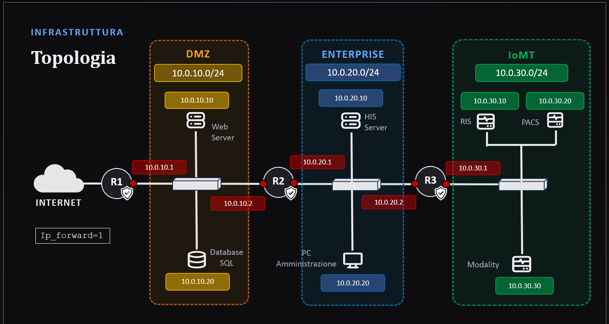
  <br>
  <em>Figura 1: Topologia di rete ospedaliera segmentata in DMZ, Enterprise e IoMT, con router firewall dedicati (R1, R2, R3).</em>
</p>

```mermaid
graph LR
    subgraph WAN ["Perimetro Esterno"]
        EXT["Internet"]
    end

    subgraph FW1 ["Perimetro DMZ"]
        R1["Router R1 (Firewall)"]
    end

    subgraph DMZ_NET ["Zona Demilitarizzata - DMZ (10.0.10.0/24)"]
        S_WEB["Web Server (10.0.10.10)"]
        S_DB["Database SQL (10.0.10.20)"]
    end

    subgraph FW2 ["Perimetro Enterprise"]
        R2["Router R2 (Firewall)"]
    end

    subgraph ENT_NET ["Rete Ospedaliera - Enterprise (10.0.20.0/24)"]
        S_HIS["HIS Server (10.0.20.10)"]
        PC_ADM["PC Amministrazione (10.0.20.20)"]
    end

    subgraph FW3 ["Perimetro Dispositivi Medici"]
        R3["Router R3 (Firewall)"]
    end

    subgraph IOMT_NET ["Rete Biomedica - IoMT (10.0.30.0/24)"]
        S_RIS["RIS Server (10.0.30.10)"]
        S_PACS["PACS Server (10.0.30.20)"]
        S_MOD["Modality TAC (10.0.30.30)"]
        ATT["Host Attaccante (10.0.30.99)"]
    end

    EXT <--> R1
    R1 <--> DMZ_NET
    DMZ_NET <--> R2
    R2 <--> ENT_NET
    ENT_NET <--> R3
    R3 <--> IOMT_NET

    style IOMT_NET fill:#1e293b,stroke:#ef4444,stroke-width:2px,color:#fff
    style ENT_NET fill:#0f172a,stroke:#3b82f6,stroke-width:2px,color:#fff
    style DMZ_NET fill:#1e1b4b,stroke:#f59e0b,stroke-width:2px,color:#fff
    style ATT fill:#7f1d1d,stroke:#f87171,stroke-width:2px,color:#fff
```

### Mappatura Nodi e Porte di Rete

| Host | Segmento | Indirizzo IP | Indirizzo MAC | Servizio / Porta TCP | Descrizione |
|---|---|---|---|---|---|
| `h_ris` | IoMT | `10.0.30.10` | `02:00:0a:00:1e:0a` | `2576` (Listener ORM) | Radiology Information System: genera i referti diagnostici |
| `h_pacs` | IoMT | `10.0.30.20` | `02:00:0a:00:1e:14` | `2575` (Listener MLLP) | Picture Archiving & Comm. System: archivio immagini TAC/RM |
| `h_mod` | IoMT | `10.0.30.30` | `02:00:0a:00:1e:1e` | - | Macchinario di imaging biomedicale (Modality) |
| `h_att` | IoMT | `10.0.30.99` | Variabile (Virtual) | - | **Nodo Kali Linux dell'Attaccante** |
| `his_srv` | Enterprise | `10.0.20.10` | `02:00:0a:00:14:0a` | `2577` (Listener HIS) | Hospital Information System: cartella clinica centrale |
| `web_srv` | DMZ | `10.0.10.10` | `02:00:0a:00:0a:0a` | `80` (HTTP), `443` (HTTPS) | Portale prenotazioni online e referti web |

---

## Protocollo Clinico HL7 v2.x & Framing MLLP

Le comunicazioni sanitarie rispettano lo standard internazionale **HL7 (Health Level Seven) versione 2.5**, incapsulato nel protocollo di trasporto **MLLP (Minimal Lower Layer Protocol)** su socket TCP:

```
┌──────┬───────────────────────────────────────────────────────┬──────┬──────┐
│ 0x0B │ Messaggio HL7 ASCII (segmenti separati da CR '\r')    │ 0x1C │ 0x0D │
└──────┴───────────────────────────────────────────────────────┴──────┴──────┘
   VT  (Inizio Blocco)                                             FS     CR   (Fine)
```

### Flusso di Lavoro Clinico (Fasi 7 & 8)

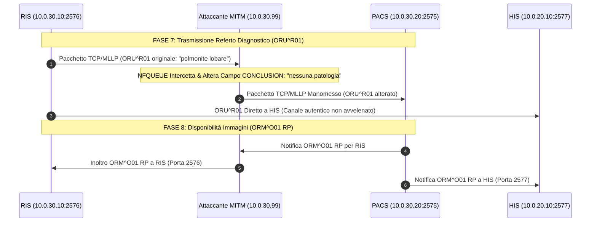

### Anatomia del Messaggio Bersaglio: `ORU^R01`
```hl7
MSH|^~\&|RIS|RADIOLOGY|PACS|ARCHIVE|20240115150000||ORU^R01|MSG006|P|2.5
PID|1||PAZ001^^^HIS||Rossi^Mario||19800315|M
OBR|1|ORD001|ACC001|TAC^TC Torace|||20240115130000|||||||20240115145000||RAD001
OBX|1|TX|FINDINGS||Polmoni con addensamento in base destra. Suggestivo per polmonite.||
OBX|2|TX|CONCLUSION||Referto: polmonite lobare destra. Raccomandato follow-up a 30 giorni.||
```
* **Vettore di Manomissione:** Nel segmento `OBX|2`, il testo diagnostico risiede all'indice 5 (`campi = riga.split('|')[5]`). Lo script intercetta la stringa ed esegue la sostituzione in-memory.

---

## Vettore d'Attacco: Offensive Engineering & Exploitation

<p align="center">
  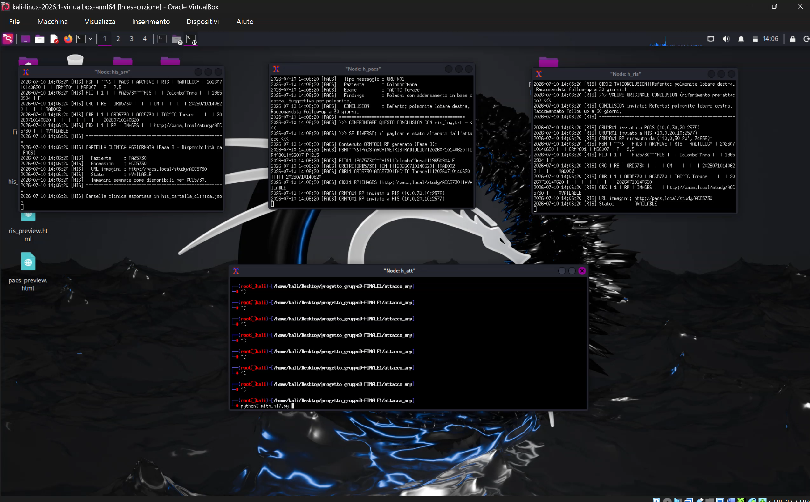
  <br>
  <em>Figura 2: Dashboard terminali concorrenti in Mininet: HIS, PACS, RIS e shell dell'attaccante in ascolto.</em>
</p>

### 1. Network Reconnaissance (NMAP & ARP Sweeping)
Dalla postazione dell'attaccante (`h_att`), viene scansionato l'intero segmento IoMT per mappare topologia e servizi attivi:

<p align="center">
  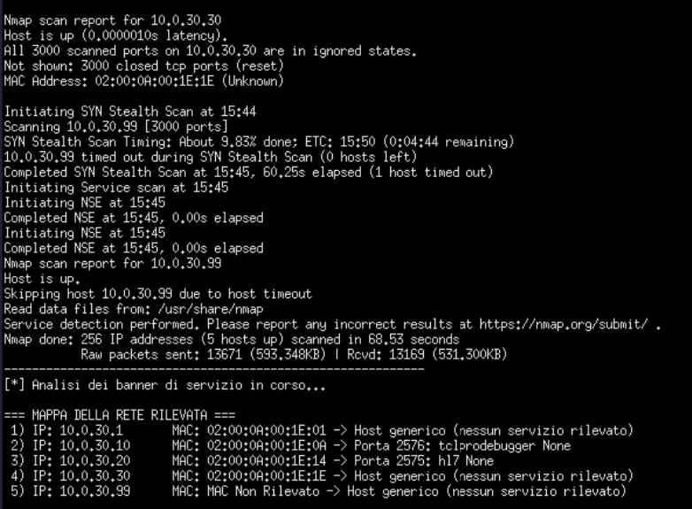
  <br>
  <em>Figura 3: Output della scansione NMAP con identificazione dei MAC address e delle porte MLLP aperte (2575, 2576).</em>
</p>

```bash
# Esecuzione scansione stealth e identificazione porte
nmap -sS -p 2570-2580 10.0.30.0/24
```

### 2. Bidirectional ARP Cache Poisoning (Man-in-the-Middle)
L'attaccante genera in loop continuo pacchetti ARP reply gratuiti non richiesti:
* Invia a `10.0.30.10` (RIS): *"L'IP 10.0.30.20 (PACS) ha il MAC dell'attaccante"*.
* Invia a `10.0.30.20` (PACS): *"L'IP 10.0.30.10 (RIS) ha il MAC dell'attaccante"*.

<p align="center">
  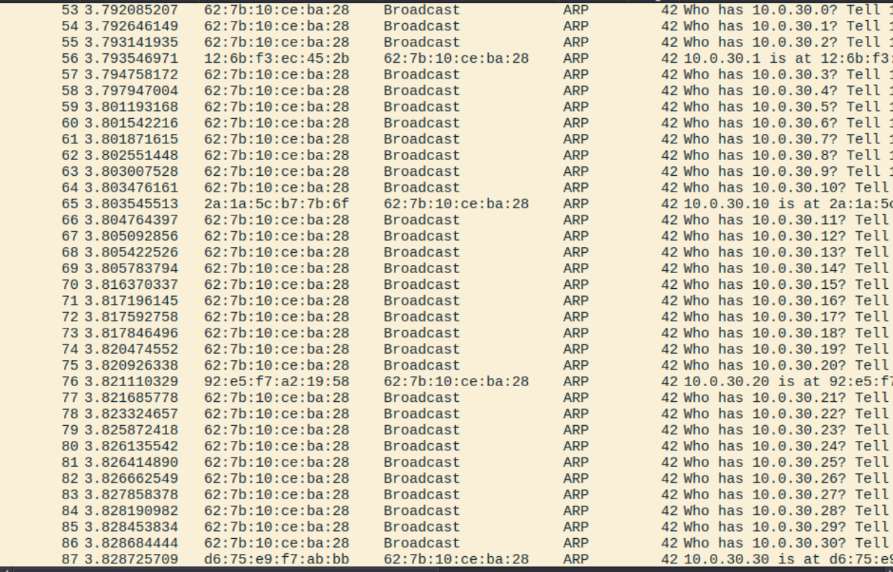
  <br>
  <em>Figura 4: Analisi dei pacchetti Wireshark: tempesta di frame ARP broadcast e avvelenamento della cache dei router/host.</em>
</p>

### 3. Intercettazione e Manipolazione L7 con NetfilterQueue
Il kernel Linux dell'attaccante attiva l'inoltro dei pacchetti e instrada il traffico TCP su code netfilter:
```bash
sysctl -w net.ipv4.ip_forward=1
iptables -t mangle -A FORWARD -p tcp --dport 2575 -j NFQUEUE --queue-num 1
iptables -t mangle -A FORWARD -p tcp --sport 2576 -j NFQUEUE --queue-num 1
```

Lo script Python `mitm_hl7.py` aggancia la coda `NFQUEUE 1`, parsa il frame MLLP e offre il menu di iniezione a 5 livelli:

<p align="center">
  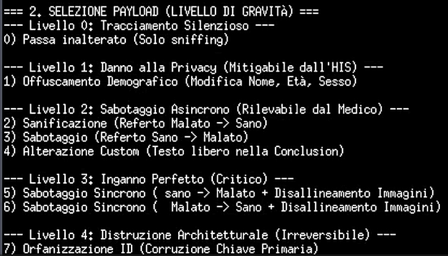
  <br>
  <em>Figura 5: Menu interattivo di selezione del payload dannoso per gravità d'impatto clinico.</em>
</p>

### 4. Evidenza del Tampering nei Pacchetti (Wireshark)
Il confronto tra il frame catturato sul RIS e il frame re-iniettato verso il PACS evidenzia l'alterazione del payload e la modifica della lunghezza del segmento TCP:

<p align="center">
  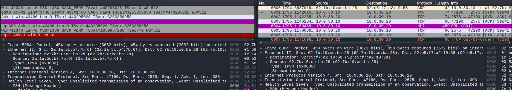
  <br>
  <em>Figura 6: Cattura Wireshark: Frame 5984 originale (454 byte) vs Frame 6004 modificato (459 byte) con ricalcolo TCP Sequence/Ack numbers.</em>
</p>

---

## Strategie di Difesa in Profondità (Defense in Depth)

### Difesa 1: Mutual TLS (mTLS) a Livello Applicativo
Implementazione della crittografia forte end-to-end con certificati digitali X.509 generati tramite OpenSSL:
* Creazione di una **Private Healthcare Certificate Authority (CA)** interna.
* Rilascio di certificati con estensioni SAN (Subject Alternative Name) per ciascun nodo (`ris.crt`, `pacs.crt`, `his.crt`).
* Mutua autenticazione bilaterale obbligatoria: il client verifica il certificato del server, e il server verifica quello del client.

<p align="center">
  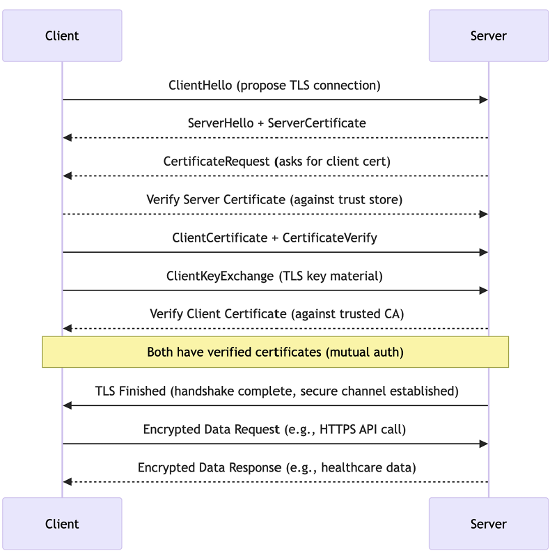
  <br>
  <em>Figura 7: Diagramma del flusso di handshake e mutua autenticazione con certificati X.509 in mTLS.</em>
</p>

<p align="center">
  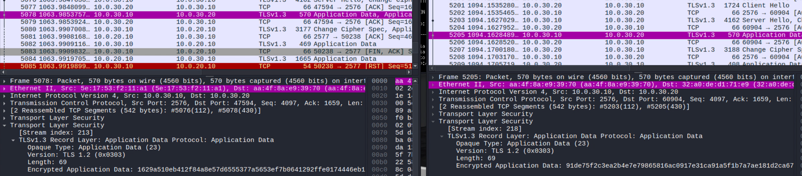
  <br>
  <em>Figura 8: Traffico catturato sotto mTLS: l'attaccante intercetta esclusivamente frame cifrati TLSv1.3 (Application Data oscurato).</em>
</p>

### Difesa 2: mTLS + Binding Statico MAC (Static ARP)
Sebbene mTLS protegga la confidenzialità e l'integrità del dato medico, un attaccante MITM su switch non protetto può comunque interrompere il canale TLS provocando un **Denial of Service (DoS)**.
La soluzione definitiva implementa una difesa multi-layer:
* **Tabelle ARP Statiche nel Kernel:** Istanziate con `arp -s <IP> <MAC>` o tramite neighbor tables fisse nei router e negli host.
* **Risultato:** Le risposte ARP fasulle inviate dall'attaccante vengono scartate direttamente a livello di scheda di rete. L'attacco ARP Spoofing fallisce al 100%, garantendo **Zero Alterazioni e Continuità Totale del Servizio**.

<p align="center">
  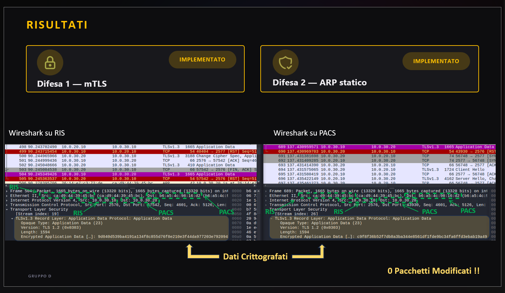
  <br>
  <em>Figura 9: Risultati finali della mitigazione: canali mTLS attivi, tabelle ARP blindate e 0 pacchetti modificati.</em>
</p>

---

## Benchmark Comparativo degli Scenari

| Parametro / Metrica | Scenario 1: Baseline Vulnerabile | Scenario 2: Attacco MITM Attivo | Scenario 3: Difesa 1 (mTLS) | Scenario 4: Difesa 2 (mTLS + ARP Statico) |
|---|:---:|:---:|:---:|:---:|
| **Crittografia Payload** | Nessuna (Cleartext MLLP) | Nessuna (Cleartext MLLP) | **TLSv1.3 / AES-GCM** | **TLSv1.3 / AES-GCM** |
| **Autenticazione Host** | Nessuna | Nessuna (Impersonificazione) | **Mutua (Certificati X.509)** | **Mutua + Validazione MAC** |
| **Vulnerabilità ARP Spoofing** | Critica | Sfruttata con successo | Parziale (Rischio DoS) | **Totalmente Immune** |
| **Riservatezza Dati Paziente** | Compromessa | Compromessa (Sniffing L7) | **Garantita al 100%** | **Garantita al 100%** |
| **Integrità Diagnosi Medica** | Compromessa | **Alterata (Sabotaggio Clinico)** | **Inviolabile** | **Inviolabile** |
| **Disponibilità Rete (DoS)** | Alta | Rischio disconnessione TCP | Possibile DoS da spoofing | **Continua e Determinata** |

---

## Struttura del Repository

```
Ethical-Hacking-Secure-Network-Architecture/
├── attacco_arp/                      # Scenario vulnerabile di baseline e scripts di exploit
│   ├── topo.py                       # Definizione topologia di rete Mininet a 3 zone
│   ├── run.py                        # Orchestratore per avvio Mininet e assegnazione IP/MAC
│   ├── setup_firewall.sh             # Configurazione iniziale firewall iptables su R1, R2, R3
│   ├── ris_server.py                 # Generatore di referti radiologici (Fase 7 - ORU^R01)
│   ├── pacs_server.py                # Server PACS di archiviazione (Fase 8 - ORM^O01 RP)
│   ├── his_server.py                 # Server HIS per cartella clinica ospedaliera
│   ├── hl7_parser.py                 # Libreria di parsing MLLP e costruzione segmenti HL7
│   ├── mitm_hl7.py                   # Script di Ethical Hacking (ARP Poisoning + NFQUEUE Tampering)
│   ├── test_connectivity.py          # Script di test connettività inter-segmento
│   └── hl7_dashboard.html            # Dashboard web per il monitoraggio in tempo reale dell'attacco
├── difesa1_mTLS/                     # Scenario di mitigazione tramite Crittografia mTLS
│   ├── certs/                        # Certificate Authority (CA), certificati client/server e chiavi
│   │   ├── ca.crt / ca.key           # Root Certificate Authority
│   │   ├── ris.crt / ris.key         # Certificato e chiave privata del RIS
│   │   ├── pacs.crt / pacs.key       # Certificato e chiave privata del PACS
│   │   └── his.crt / his.key         # Certificato e chiave privata dell'HIS
│   ├── ris_server.py                 # Server RIS con wrapping mTLS (ssl.wrap_socket)
│   ├── pacs_server.py                # Server PACS con autenticazione client/server
│   └── his_server.py                 # Server HIS con certificati abilitati
├── difesa2_mTLS+MAC_static/          # Scenario di blindatura totale (mTLS + Binding Statico MAC)
│   ├── setup_firewall.sh             # Script con tabelle ARP statiche e blocco spoofing a L2
│   ├── certs/                        # Infrastruttura PKI crittografica completa
│   └── ...                           # Server applicativi configurati in modalità sicura
├── docs/
│   └── assets/                       # Catture Wireshark, diagrammi e screenshot dei terminali
│       ├── topologia_rete_ospedaliera.png
│       ├── reconnaissance_scansione_nmap.png
│       ├── wireshark_arp_sniffing.png
│       ├── wireshark_hl7_mitm_before_after.png
│       ├── menu_attacco_payload_injection.png
│       ├── terminale_mininet_multi_nodo.png
│       ├── architettura_handshake_mtls.png
│       ├── wireshark_convalida_mtls.png
│       └── risultati_difese_zero_alterazioni.png
├── .gitignore                        # Regole di esclusione per cache Python, log e dump pcap
└── README.md                         # Documentazione tecnica approfondita
```

---

## Guida all'Avvio e Riproducibilità

### Prerequisiti
* Sistema Operativo: **Kali Linux** (o VM Ubuntu con privilegi di root)
* Software installato: `mininet`, `openvswitch-switch`, `wireshark`, `python3-scapy`, `iptables`

### 1. Avvio dell'Ambiente Mininet (Scenario Attacco)
```bash
cd attacco_arp
sudo python3 run.py
```

### 2. Esecuzione dei Sistemi Clinici nella CLI di Mininet
Dalla prompt `mininet>`:
```bash
mininet> his_srv python3 his_server.py &
mininet> h_pacs  python3 pacs_server.py &
mininet> h_ris   python3 ris_server.py --intervallo 5 &
```

### 3. Esecuzione dell'Attacco Man-in-the-Middle
Aprire una console sull'host attaccante `h_att`:
```bash
mininet> xterm h_att
```
Nella shell dell'attaccante:
```bash
python3 mitm_hl7.py
# Selezionare l'opzione desiderata (es. Livello 2: Sabotaggio Sanificazione Malato -> Sano)
```

### 4. Verifica dei Log e della Manomissione
Confrontare i log di generazione con quelli di ricezione:
```bash
mininet> h_ris  tail -n 10 ris_log.txt   # Referto originale emesso
mininet> h_pacs tail -n 10 pacs_log.txt  # Referto alterato ricevuto dall'archivio
```

---

## Team & Crediti

Progetto accademico ingegnerizzato per il corso di **Cyber Security per Sistemi Biomedicali** (A.A. 2025/2026) dal **Gruppo D**:
* **Alessandro Ronan Reinoso Dominguez** — *Offensive Security, Penetration Testing & MitM Engine Lead*
* **Maria Chiara De Blasio**
* **Alessandro Sorrentino**
* **Chiara Vuono**
* **Maurizio Cavuto**
* **Giuseppe Netti**

---
*Per domande, analisi di vulnerabilità o collaborazioni sull'architettura di sicurezza per sistemi ospedalieri e dispositivi IoMT, visita [ronanreinoso.dev](https://porfolio-rard.web.app).*
